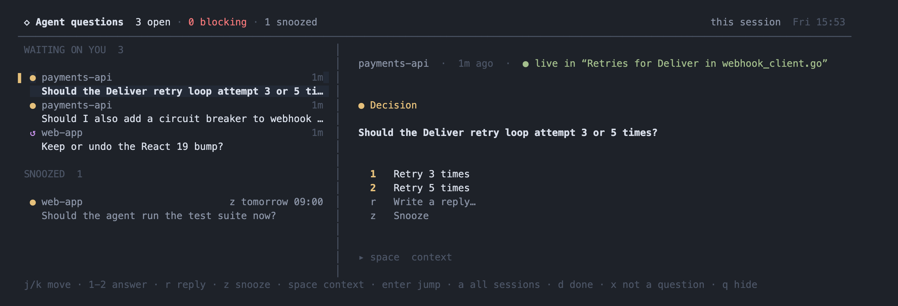

# rexq

rexq collects the questions Claude Code agents leave for you (decisions, vetoes, things to do by hand, leftovers) into one panel inside [Rex](https://www.superlogical.com/rex). A Claude `Stop` hook sends each final message to Haiku through `claude -p` on your own login, stores the items it finds in SQLite, and a floating Rex panel lists them. From the panel you answer, snooze, mark done, or jump to the agent.



## Requirements

- macOS only: it is built and tested there.
- Go 1.26 or newer, to build it.
- Claude Code, tested with 2.1.319. rexq uses async `Stop` hooks, `SessionStart` and `UserPromptSubmit` hooks, and `claude -p --safe-mode --json-schema --strict-mcp-config`.
- Rex, tested with build 0.0.1793645657 (2026-11-02). The panel module uses the Lua APIs `rex.action`, `rex.bind` and `rex.session` (`view`, `list_blocks`, `new_block`, `move_block`, `float_block`, `focus_block`, `detach_block`). The binary runs the `rex` CLI: `block inspect`, `block call` (`program_status`, `process`, `title`), `capture`, `send`, `send-key`, `run`, `focus`, `whoami`, `client ls`, `do session.select` and `api call` (`session.view`, `session.detach_block`).
- `python3` for the hook installer, and `ps` and `lsof` (part of macOS), which the panel uses to find running Claude processes.
- `git` or `jj`, optional: they name an item's project and branch. Without them it's the directory name.
- `sqlite3`, optional, for troubleshooting.

## Cost

Each agent turn whose final message may leave something for you (a cheap local filter decides) costs one Haiku call, billed to your Claude plan like any other `claude -p` run. Turns that plainly leave nothing cost nothing.

## Install

```sh
go install github.com/tfcace/rexq/cmd/rexq@latest
command -v rexq    # the path the Rex module needs below
```

The hook installer and the Rex module live in this repository:

```sh
git clone https://github.com/tfcace/rexq && cd rexq
python3 scripts/install-hooks.py      # adds the hooks to ~/.claude/settings.json
```

To build from that checkout instead of `@latest`, run `go install ./cmd/rexq` in it.

The installer backs up `settings.json` first (or creates it), leaves other hooks alone, and refuses a missing or broken binary. It writes `$CLAUDE_CONFIG_DIR/settings.json` when `CLAUDE_CONFIG_DIR` is set, and uses the `rexq` on `PATH`, else the one `go install` made. Both can be given: `install-hooks.py [settings.json [rexq binary]]`.

The hooks run `claude -p`, so `claude` must be on `PATH` in the environment Claude Code runs hooks in. If it isn't, set `REXQ_CLAUDE` to its full path there.

### The Rex panel

Copy the module next to the `init.lua` Rex reads: `~/.config/rex/`, or `$XDG_CONFIG_HOME/rex/` when that is set, or beside the file `REX_CONFIG` names.

```sh
mkdir -p ~/.config/rex
cp rex/rexq.lua ~/.config/rex/
```

Add this to `init.lua`, with the path `command -v rexq` printed, and reload the config (`rex config reload`):

```lua
require("rexq").setup{ key = "shift+cmd+i", bin = "/path/to/rexq" }
```

`shift+cmd+i` shows the panel over the current tab and hides it again. The action is also in the command palette as "Toggle Agent Questions".

### Earlier sessions

New Claude sessions are tracked from then on. To pick up the last turn of sessions from the past week, once:

```sh
rexq backfill --dry-run   # lists the sessions it would extract, calls nothing
rexq backfill             # one claude -p call per session
```

## How it works

- **Hooks.** `SessionStart` ties the Claude session to the Rex pane it runs in. `UserPromptSubmit` notes what you said, so questions you've answered since are set aside. `Stop` runs async, so Claude never waits: it filters the final message, asks Haiku for the items in it, and stores them. Headless runs (`claude -p`, the SDK) are skipped. A failed extraction is queued and retried on later stops.
- **Store.** One SQLite file, shared by the hooks and the panel. `rexq list -all` prints what's open.
- **Panel.** A Bubble Tea program in a floating Rex block, one per Rex session. It shows that session's questions, or all of them.
- **Replies.** rexq types into a live pane only when Claude Code runs there, is idle (not working, not showing a dialog), and its input box is empty, and it checks the box holds exactly the reply before pressing Enter. Replies are one line; ones starting with `/` or `!` are refused, since Claude would run them as commands. If you've written to that agent since it asked, rexq refuses: jump there instead, or mark it done. Without a live pane it runs `claude --resume` in a new tab, in the directory the conversation started in, and never while another Claude runs in that directory.

## Keys

| Key | Does |
| --- | --- |
| `j` `k` | move |
| `1` `2` `3` | send that answer |
| `r` | write a reply, `enter` sends it |
| `z` | snooze: 1 hour, this evening, tomorrow 9:00, Monday 9:00, or until the agent next stops |
| `u` | wake a snoozed question; right after a change, undo it (also `U`) |
| `d` | done: you handled it |
| `x` | not a question: dismiss it |
| `space` | show the context: the agent's words, your prompt, screenshots |
| `enter` | jump to the agent's pane, or resume the conversation in a new tab |
| `a` | this Rex session or all of them |
| `q` `esc` | hide the panel (quit when it runs outside the Rex layer) |
| `ctrl+c` | quit |

## Where things live

- `~/.local/state/rex-questions/questions.db`: the store (SQLite, WAL). Set `REXQ_DB` to use another file; the log and locks move with it.
- `locks/` beside the store: 64 shard files the `Stop` hooks lock, so one session's turns are extracted one at a time.
- `hook.log` beside the store: hook errors and notes. At 1 MiB it moves to `hook.log.1` and starts over.

The directory is created `0700` and the files in it `0600`.

## Troubleshooting

- Nothing shows up: look at `hook.log`. A logged-out `claude`, a `claude` missing from the hooks' `PATH`, or a usage limit shows there, and the panel's header warns ("extraction failing") while it lasts.
- Failed extractions wait in the `pending` table and are retried on later stops for about 2h42m: `sqlite3 ~/.local/state/rex-questions/questions.db 'select id, claude_session, attempts, datetime(next_at, "unixepoch", "localtime") from pending'`.
- `rexq list -all` prints every open question, outside the panel.
- A session started before the hooks were installed takes its pane at its next stop, if no other conversation has claimed that pane. Until then the panel can only resume it, and refuses while it runs.

## Uninstall

```sh
python3 scripts/install-hooks.py --uninstall   # removes only rexq's hooks, with a backup
```

It leaves an empty `"hooks": {}` behind if rexq's were the only hooks. The installer's backups sit beside the settings file as `settings.json.bak-*`; delete them when you no longer need them.

Then remove the `require("rexq")` line from `init.lua`, delete `rexq.lua` beside it and the `rexq` binary (`command -v rexq`), and if you want the data gone too, `~/.local/state/rex-questions/`.

## License

MIT
